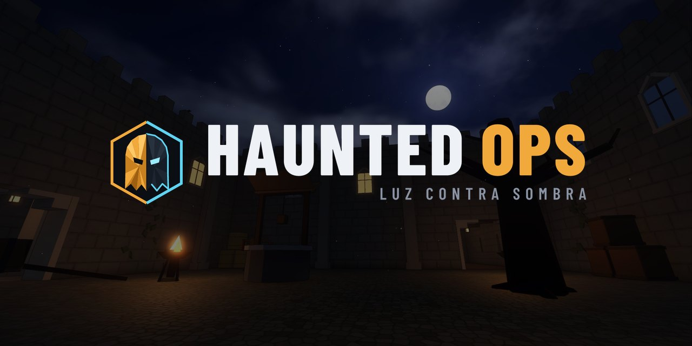
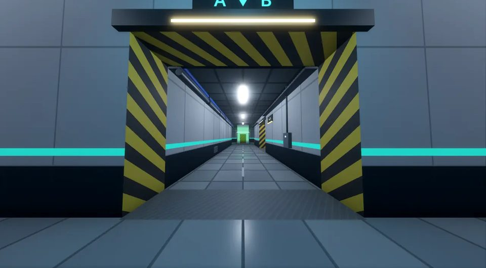
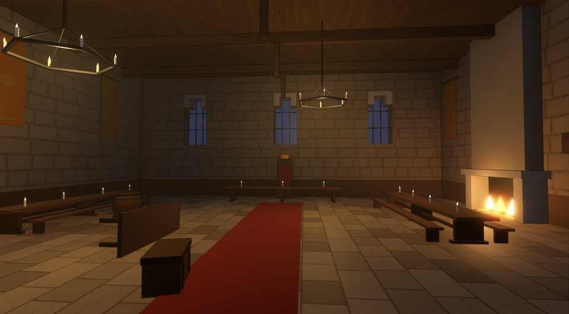
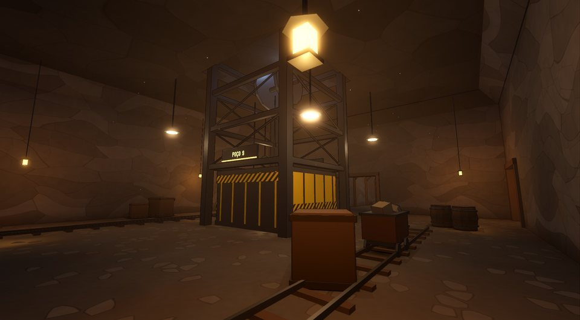
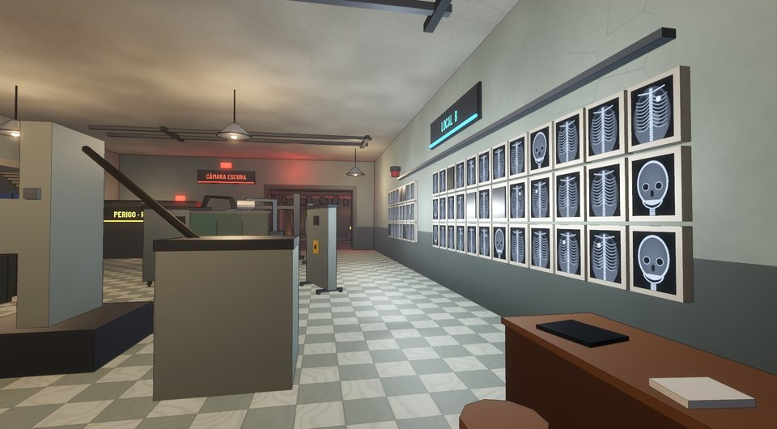

  

  <b>FPS tático 5v5 em low poly. Grátis.</b> 
  A Ordem da Lanterna contra as Sombras, invisíveis quando paradas.

  
  
  

---

## Baixar

No Android, o jogo está em **teste fechado na Google Play**: [inscreva-se no grupo de testadores](https://groups.google.com/g/hauntedops-testers/about) com a conta Google do celular e, depois da aprovação, toque em *Tornar-se testador* na [página do teste](https://play.google.com/apps/testing/com.hauntedops.game). Tudo explicado em **[hauntedops.com.br](https://hauntedops.com.br/#baixar)**.

| Sistema | Arquivo | |
|---|---|---|
| **Windows** 10 ou 11 (64 bits) | [HauntedOps-Setup.exe](https://github.com/DouglasVulcano/haunted-ops-releases/releases/latest/download/HauntedOps-Setup.exe) | Instalador. O jogo se atualiza sozinho a cada abertura. |
| **macOS** (beta) | [HauntedOps-Setup-macOS.zip](https://github.com/DouglasVulcano/haunted-ops-releases/releases/latest/download/HauntedOps-Setup-macOS.zip) | Apple Silicon e Intel. Na primeira vez: botão direito no app › Abrir. |
| **Android** 7 ou mais novo (64 bits) | [Google Play (teste fechado)](https://groups.google.com/g/hauntedops-testers/about) | Controles de toque. A Play atualiza o jogo sozinha. |
| **iPhone e iPad** | Em desenvolvimento | |

## O jogo

<!-- eco:mapas-fotos · GERADO pela central (haunted-ops-devkit/ecossistema); não editar à mão -->
<table>
  <tr>
    <td width="50%"> <b>Laboratório</b></td>
    <td width="50%"> <b>Castelo Ravenmoor</b></td>
  </tr>
  <tr>
    <td width="50%"> <b>Mina (o Poço Nove)</b></td>
    <td width="50%"> <b>Sanatório Santa Luzia</b> (chega na versão 0.16.16)</td>
  </tr>
</table>
<!-- /eco:mapas-fotos -->

- **Modo bomba, 1v1 a 5v5.** As Sombras tentam plantar a Carga de Ruptura em A ou B; os Lanternas defendem.
- **Pistola contra faca.** Os Lanternas têm pistola e a fumaça reveladora, que denuncia as Sombras andando dentro dela. As Sombras só têm lâmina, mas somem quando ficam paradas.
- **Quatro mapas:** o Laboratório, fechado, com três rotas e dutos; o Castelo Ravenmoor, de noite, com cripta e passagens secretas; a Mina, em túneis debaixo da terra; e o Sanatório Santa Luzia, na serra (chega na versão 0.16.16). <!-- eco:mapas-lista -->
- **Salas oficiais em São Paulo**, que ligam sozinhas quando alguém entra. Você também pode criar a sua sala e mandar o código para os amigos.
- **PC e celular na mesma sala.**

## Sobre este repositório

Aqui ficam só os instaladores da **versão mais recente**: todos precisam da mesma versão para jogar juntos. Os outros arquivos de cada release são usados pelo próprio jogo e pelos servidores para se atualizar; você não precisa baixá-los.

O jogo não é de código aberto. O item "Source code" que o GitHub mostra em toda release contém apenas este README e as imagens desta página.

© Haunted Ops. Todos os direitos reservados.

